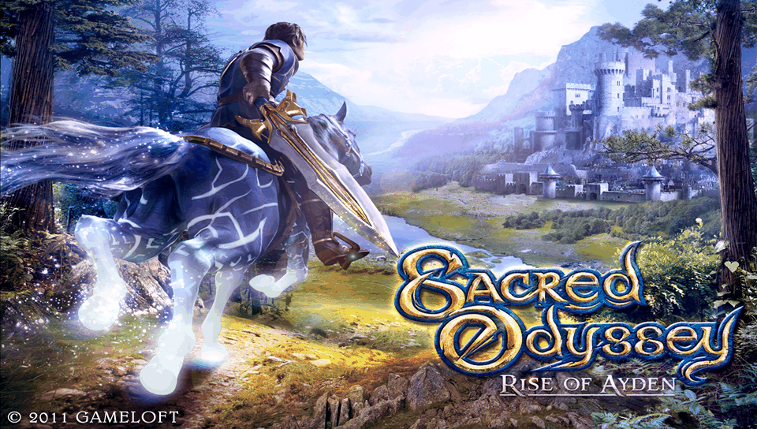

<h1 align="center">
  <br>
  Sacred Odyssey: Rise of Ayden · PS Vita Port
</h1>

<p align="center">
  <b>Native port of Sacred Odyssey: Rise of Ayden (Gameloft) for PlayStation Vita and PlayStation TV.</b>
</p>

<p align="center">
  
  
  
  
  
  
</p>

<p align="center">
  <a href="#-description">Description</a> •
  <a href="#-features">Features</a> •
  <a href="#-controls">Controls</a> •
  <a href="#-installation">Installation</a> •
  <a href="#-known-issues">Known Issues</a> •
  <a href="#-building-from-source">Build</a> •
  <a href="#-credits">Credits</a>
</p>

---

## 📖 Description

An unofficial, native **Android-to-PS Vita wrapper port** of *Sacred Odyssey: Rise of Ayden* (Android, `com.gameloft.android.ANMP.GloftSOHP.ML`, developed by **Gameloft**, Glitch engine). It runs the original `libsacredodyssey.so` unmodified through a [SoLoader](lib/so_util) + [FalsoJNI](lib/falso_jni) bridge. No game logic was reimplemented: only the Android / JNI / OpenGL ES layer underneath it.

### 🔧 Technical notes

- **Loader**: `source/main.c` (lifecycle and render loop), `source/java.c` (FalsoJNI method table), `source/dynlib.c` (symbol resolution), `source/patch.c` (binary compatibility patches against the original `.so`).
- **Audio**: the engine's native VOX middleware is bridged from `android/media/AudioTrack` to `sceAudioOut` (44.1 kHz stereo 16-bit, dedicated output thread) (`source/audio.c`).
- **Controls and HUD**: `source/controls.c` (physical input mapping and HUD management).
- **File I/O**: `source/reimpl/io.c` (file I/O, shader and texture asset redirects, 64 MB RAM file cache with LRU eviction). `lib/fios` is the FIOS2 kernel I/O cache, tuned for this port's asset streaming.
- **Graphics**: `source/utils/glutil.c` (vitaGL wrappers, embedded-shader substitution, texture-unit guards) and `source/utils/embedded_shaders.c` (reconstructed GLSL sources embedded in the eboot). Shaders are cached persistently by vitaGL.
- **Graphics fix**: the black patches on the character and mounts came from the second texture of `MULTITEXTURED` materials, which is an *additive reflection (envmap)* map rather than a multiplicative detail layer. The embedded shader now adds it scaled by `envmapIntensity`.
- **Known trade-off**: skinned / animated meshes render in bind pose. The hardware-skinning uniform arrays were removed on purpose after they caused a harder crash (per-mesh bone-count mismatch), so those meshes log a bind-symbol warning instead of crashing. A real fix requires generating the shader per material's bone count.

---

## 🎮 Status & Playability

**Status: Playable (beta)** (VPK `01.00`, release v1.0.2)

The game boots, loads saves, and is fully playable from start to finish with a physical controller, although it is still in development and has one known open issue (erratic FPS, see [Known Issues](#-known-issues)). Full engine findings and the porting plan are in [`PORTING_PLAN.md`](PORTING_PLAN.md).

- [x] **Playable (v1.0.2, see [`RELEASE_NOTES.md`](RELEASE_NOTES.md))**: the game boots, loads saves and runs from start to finish with a controller.
- [x] **Full physical control mapping** (`source/controls.c`): left stick / D-Pad for 360° movement (radial deadzone), right stick for smooth analog camera rotation calibrated against N.O.V.A. 2 and Shadow Guardian (quadratic response curve, no camera snapping or resets, infinite 360° continuous rotation, works without touching the screen), and every face button / trigger mapped to its HUD widget: attack, shield, horse mount/dismount, minimap, pause and in-game menus. Touch screen keeps working in parallel (5 shared slots). Pressing **L+R together** reveals the full virtual HUD at full opacity.
- [x] **HUD reorganized for console play**: menu icon, character portrait/health, minimap and the weapon-switch icon stay at full opacity at all times; the rest of the touchscreen HUD is dimmed to the background (still touchable) instead of covering the screen.
- [x] **Real audio**: the engine's native VOX middleware is bridged to `sceAudioOut`, so the game is no longer mute.
- [x] **Graphics fixes**: the black patches on the character and mount are fixed (see [Technical notes](#-description)). Missing effect shaders (`Unlit*`, `ProfileCOMMON_emul_*`) are provided from reconstructed sources embedded in the eboot, so they work without reinstalling the `.vpk`.
- [x] **Loading improvements**: two real stalls inside `World::LoadMap()` (the game-object loop and the graphical-maps loop both blocked the frame without yielding) now yield periodically, plus a 64 MB RAM file cache with LRU eviction, kernel I/O cache tuning and a persistent vitaGL shader cache. Stage transitions no longer feel like a total freeze.
- [x] **Stability fixes**: a crash in World 10 cutscenes when redirecting missing textures already in RAM cache, crashes when mounting the horse (dangling `HudWidget*`, now guarded by alignment and plausibility checks), a Triangle-button crash from a stale widget-table entry, a file cache corruption during autosave / stage transitions, a cutscene fade-material crash, plus the boot-time `Gameplay::s_instance` / `FileManager` / license-check crashes from the initial bring-up. Every one was root-caused from a real console crash dump (see [`port_progress.md`](port_progress.md)).
- [ ] **Erratic FPS**: framerate fluctuates during normal gameplay (worse in boss-fight combat with heavy particles). The two hard load stalls are fixed; the remaining fluctuation is still under investigation with targeted telemetry.

### 📋 Changelog

#### v1.0.2 (2026-09-29)

- **Fix crash in World 10 / introductory cutscenes**:
  - Fixed a critical `Data abort exception (0x30004)` occurring during the introductory horse cutscene (`HorseWhite_5017`, `MCInCutScene_6520`) when loading World 10 (`mc_animation_cutscenes.bdae`).
  - The crash was caused by the loader's missing texture redirect (`KnightsOdyssey_hand2_diffuse.tga` -> `KnightsOdyssey_hand_diffuse.kot`) returning an already-cached `fcache` in-memory handle (`FCacheHandle*`) without an early return, causing the outer `fopen` logic to pass the fake handle to `SceLibc` (`sceLibcBridge_setvbuf` / `fcache_populate` -> `sceLibcBridge_fseek`).
  - Added immediate returns (`return ret;`) to all asset redirects in `fopen_soloader` and guarded the buffer setup against `fcache` handles (`!fcache_is_handle(ret)`).
- **Reworked Right Analog Stick Camera (NOVA 2 / Shadow Guardian style)**:
  - **Eliminated sudden camera snaps/resets**: previously, the camera coordinates were only reset in the axis hook when deflected. When the player released the stick, the hook was never called, leaving the accumulator frozen at 500.0f; on the next movement, the engine rotated `lastCamDir` by an instant 333° snap. Accumulation and centering reset now run unconditionally in `controls_update()` every frame.
  - **Fluid 360° rotation without freezing**: horizontal rotation now wraps smoothly at 4π (1080.0f units, matching the quaternion `fromAngleAxis` period), allowing continuous 360-degree rotation forever.
  - **Quadratic analog deadzone curve**: standard `0.15f` deadzone with quadratic response (`0.35f * t + 0.65f * t^2`) for precision aiming and smooth full-stick pans.
  - **Customizable sensitivity**: loads an optional sensitivity setting from `ux0:data/sacredodyssey/camera_sens.txt` (1..10, default 5).

**Testing & verification items for v1.0.2:**

1. Starting a new game proceeds through the intro horse cutscene in World 10 without crashes.
2. The right analog stick controls the camera smoothly with analog precision; no sudden 333° jumping or snapping when releasing and repushing the stick.
3. Continuous horizontal camera rotation turns smoothly 360° indefinitely without stopping or getting stuck.

#### v0.1.0 / v1.0.1 (initial release)

First playable version of the native port. What is in this release:

- The game boots, loads saved games, and is fully playable from start to finish with a physical controller.
- **Full physical control mapping**:
  - Left stick / D-Pad: movement.
  - Right stick: camera rotation (works without needing to touch the screen).
  - Cross, Square, Triangle, Circle, L/R triggers: mapped to the HUD's contextual actions (attack, defense, mount/dismount horse, weapon-switch menu, dialogs, treasure chests, bombs, etc.).
  - START: pause / system menu. SELECT: in-game menu / minimap.
  - L+R combo: reveals the full virtual HUD at full opacity (to inspect or directly touch any icon, including the ones that stay dimmed during normal gameplay).
- **HUD reorganized for console play**: the icons the original touchscreen UI showed all at once (designed for fingers, not a controller) are dimmed to nearly invisible (~1% opacity) during normal gameplay, except for the ones that remain relevant at all times: minimap, character portrait/health (`button_toIGM` and `status_healthGroup`), menu icon (`button_toSysIGM`), and the weapon-switch icon (`button_switchWeapon`), which remain permanently visible at full opacity. The rest of the icons stay touchable, just visually in the background.
- **Black-texture fix** on the character and mount (`MULTITEXTURED` materials): the second texture is an additive reflection (envmap) map, not a multiplicative detail layer as an earlier pass had assumed. The embedded shader now handles it correctly.
- **Stability fixes**: a crash when mounting the horse (dangling widget pointer), a corrupted file cache when invalidating entries during autosave / stage transitions, and several boot-time crashes specific to the v1.0.6 build (see `port_progress.md` for the full bug-by-bug detail).
- **Loading improvements**: two real bottlenecks inside `World::LoadMap()` (the world game-object loading loop and the scene / graphical-maps loading loop both blocked the entire frame until they finished) are fixed. Stage transitions and world-map transitions no longer feel like a total freeze.

---

## ✨ Features

| Feature | Status | Notes |
| :--- | :---: | :--- |
| Boots to gameplay | ✅ | Boots, loads saves and runs from start to finish with a controller |
| Graphics / renderer | 🟡 | vitaGL (GLES 2.0 programmable pipeline). Black character/mount patches fixed. Skinned meshes render in bind pose |
| Audio & music | ✅ | VOX middleware bridged to `sceAudioOut`; the game is no longer mute |
| Video / cutscenes | 🟡 | Introductory horse cutscene crash fixed in v1.0.2; other cutscenes depend on the same redirect fixes |
| Physical buttons | ✅ | Full mapping of face buttons, triggers, START and SELECT |
| Analog sticks / camera | 🧪 | Left stick 360° movement; right stick camera rebuilt in v1.0.2. The camera items are listed as "to check" in the release notes |
| Touch screen | ✅ | Full native multitouch, works in parallel with the physical buttons (5 shared slots) |
| Button remapping / port menu | ➖ | No remapping menu. Camera sensitivity is set in `camera_sens.txt` |
| Save data | ✅ | Loads saves; autosave and stage transitions covered by the file cache fixes |
| Native trophies | ➖ | No trophies in this port |
| Languages | 🧪 | Not documented |
| Performance | 🟡 | Load stalls fixed; FPS still erratic during gameplay (worse in boss fights with heavy particles) |
| Online / IAP / ads | ➖ | Not part of this port; boot-time license-check crashes were fixed |
| PS TV | 🧪 | Targets PS Vita and PS TV; not tested on PS TV |

Legend: `✅ Working (verified on console) · 🧪 Implemented, not yet verified on console · 🟡 Partial · ❌ Not working · ➖ Not applicable · ❔ Not documented yet`

---

## 🎯 Controls

| Vita | In-game action |
|---|---|
| Left stick / D-Pad | Movement (360°, radial deadzone) |
| Right stick | Smooth analog camera rotation (calibrated quadratic curve, 360° continuous rotation) |
| ✕ (Cross) | Sword / melee attack |
| ○ (Circle) | Defense / shield (never opens menus) |
| △ (Triangle) | Mount / dismount horse |
| □ (Square) | Minimap |
| L Trigger | Defense / shield, or target lock |
| R Trigger | Mount / dismount horse |
| L + R together | Reveal the full virtual HUD at full opacity (press again to dim it back) |
| START | Pause / system menu |
| SELECT | In-game menu / weapon switch |
| Front touch screen | Full native multitouch, works in parallel with the physical buttons above (5 shared slots) |

Menu icon, character portrait/health, minimap and the weapon-switch icon are always shown at full opacity; the rest of the touchscreen HUD is dimmed to the background (still fully touchable: dimming only changes alpha, never the visible or active flags the touch hit-test needs; see `source/controls.c`).

### ⚙️ Options

#### Camera Sensitivity Configuration

Right stick camera sensitivity is adjustable via an optional configuration file:
- File path on Vita: `ux0:data/sacredodyssey/camera_sens.txt`
- Values: integer from `1` to `10` (default is `5` = 100% standard speed).
- Created or edited with VitaShell or any text editor.

---

## 📋 Prerequisites

- A PS Vita or PS TV on Henkaku / Enso (or h-encore² / rejuvenate on recent firmware).
- **`kubridge`** installed (`kubridge.skprx`). It is explicitly checked at boot (see `source/utils/init.c`).
- **`libshacccg.suprx`** installed. It is required by any homebrew using `vitaGL` / `SceShaccCg` to compile GLSL shaders at runtime.
- A legitimate copy of the original *Sacred Odyssey: Rise of Ayden* Android APK / data. This repository does **not** include or distribute the APK, the `.so`, or the game's assets (see `.gitignore`); only the port's loader code is included.

---

## 📦 Installation

1. Install the generated `.vpk` (`build/sacredodyssey.vpk`) with VitaShell. You can also upload `build/eboot.bin` directly to `ux0:app/SODY00001/eboot.bin`.
2. From the original Android install, copy the following to `ux0:data/sacredodyssey/` on the Vita:
   ```text
   ux0:data/sacredodyssey/
   ├── libsacredodyssey.so
   ├── res/            (drawable, layout, raw)
   └── GloftSOHP/
       └── data/       (3d, 2d, audio, menus, automat, ...)
   ```
3. Launch the game. The first run creates its own saves and logs under `ux0:data/sacredodyssey/saves/` and `ux0:data/sacredodyssey/logs/`.

### Final File Structure in `ux0:data/sacredodyssey/`

```text
ux0:data/sacredodyssey/
├── libsacredodyssey.so   <- from the original Android install
├── res/                  <- drawable, layout, raw
├── GloftSOHP/data/       <- 3d, 2d, audio, menus, automat, ...
├── camera_sens.txt       <- optional camera sensitivity (1..10)
├── saves/                <- created on first run
└── logs/                 <- created on first run
```

---

## 🐛 Known Issues

- **Erratic FPS**: framerate fluctuates noticeably during normal gameplay (spikes and dips within the same scene, short of the severe freezes already fixed during loading transitions). This is the only open issue reported as of v1.0.2. It will keep being investigated with targeted telemetry in upcoming versions.
- **Skinned meshes in bind pose**: see the known trade-off in [Technical notes](#-description).
- **Camera on v1.0.2**: the camera behaviour was rebuilt in v1.0.2 and is listed as "to check" in the release notes until confirmed on hardware.
- **Policy**: one confirmed bug at a time, with real-hardware evidence before calling it closed. See [`port_progress.md`](port_progress.md) for the full history of confirmed bugs and their root causes.
- **Logs and crash dumps**: the game writes logs to `ux0:data/sacredodyssey/logs/`. Crash dumps (`.psp2dmp`) are written by the system to `ux0:data/`.

---

## 🔨 Building from Source

Requires [VitaSDK](https://vitasdk.org/) installed and on your `PATH`.

```sh
export VITASDK=/path/to/vitasdk
export PATH="$VITASDK/bin:$PATH"

mkdir -p build && cd build
cmake .. -DCMAKE_BUILD_TYPE=Release
make -j$(nproc)
```

It can also be built and deployed with `psvita-port-toolkit` (see below):

```sh
psvita-toolkit build --preset release
psvita-toolkit deploy --vpk
```

This port does not keep a local copy of `porting_tools/`. All build, deploy and debug work goes through **psvita-port-toolkit**, which is a standalone tool outside this repository. Its settings are in `.psvita-toolkit.json`.

### 🧭 Development workflow

1. Analyze the `.so`'s symbols before touching the loader (engine: Gameloft Glitch, GLES2 programmable pipeline, `.bdae`/Collada-derived models, `ALicenseCheck` anti-tamper).
2. Bootstrap the loader (SoLoader + FalsoJNI + Bionic ↔ VitaSDK ARM compatibility patches).
3. Build and deploy via `psvita-port-toolkit` to real hardware.
4. One confirmed bug at a time, cross-referencing a real log, `.psp2dmp`, Ghidra pseudo-C and decompiled Java source. Never a speculative patch without evidence.
5. Every confirmed bug gets documented in `port_progress.md` with its root cause.

---

## 📁 Project Structure

- `source/`: the loader. `main.c` (lifecycle and render loop), `controls.c` (physical input mapping and HUD management), `audio.c` (AudioTrack → `sceAudioOut` bridge), `patch.c` (binary compatibility patches), `java.c` (FalsoJNI method table), `dynlib.c` (symbol resolution), `reimpl/io.c` (file I/O, shader and texture redirects, RAM cache), `utils/glutil.c` (vitaGL wrappers), `utils/embedded_shaders.c` (embedded GLSL sources).
- `lib/so_util`, `lib/falso_jni`: SoLoader and FalsoJNI framework.
- `lib/fios`: FIOS2 kernel I/O cache (tuned up for this port's asset streaming).
- `lib/vitagl`: vendored [vitaGL](https://github.com/Rinnegatamante/vitaGL) submodule, built from source (`SOFTFP_ABI=1 NO_SPLASHSCREEN=1 HAVE_SHADER_CACHE=1` plus performance flags, see `CMakeLists.txt`).
- `extras/shaders/`: reconstructed GLSL shader sources, mirrored by the embedded copies in `source/utils/embedded_shaders.c` so they install themselves on first run.
- `decompiled/`: decompiled Java (jadx) and pseudo-C (Ghidra) of the original `.so`, used for crash triage (gitignored, regenerable).
- `RELEASE_NOTES.md`: what each release contains and its known issues.
- `PORTING_PLAN.md`: living porting plan, updated as real engine details get confirmed.
- `port_progress.md`: bug log, one confirmed bug at a time, each with its real root cause and fix.
- `.psvita-toolkit.json`: configuration for `psvita-port-toolkit`.

---

## 📜 Disclaimer

**Sacred Odyssey: Rise of Ayden** and its engine (Gameloft Glitch) are property of **Gameloft**. This repository makes no claim of authorship over the original game.

This software does NOT contain original game code, binaries, copyrighted graphics, or game assets. The authors do not promote or condone piracy in any way. To play, you must provide your own legitimate copy of the game's Android APK / data.

---

## ☕ Support My Work

This project is **free** and will stay free. If you enjoy it, a tip from **$1** helps me keep porting games to the PS Vita:

<p align="center">
  <a href="https://ko-fi.com/metalsyntax"></a>
</p>

- **Ko-fi:** [ko-fi.com/metalsyntax](https://ko-fi.com/metalsyntax)
- **PayPal:** [paypal.me/MetalSyntax](https://paypal.me/MetalSyntax)
- **Bitcoin (BTC):** `133HdCsaWxdjTfmwpgGVykByhNBV338uRc`

**Ko-fi supporters get:**
- **Early access** to new ports before their public release (test builds of upcoming projects).
- **Data preparation scripts and step-by-step guides** to set up your own game files for each new port.
- A say in which games I port next.

> Game files are never distributed. You always need your own legally obtained copy of the game.

---

## 👥 Credits

- **Sacred Odyssey: Rise of Ayden** and its engine (Gameloft Glitch) are property of **Gameloft**.
- **Wonder Diaz**: This port.
- **Andy "TheFloW" Nguyen**: For the original Android `.so` loader concept.
- **Rinnegatamante**: For [vitaGL](https://github.com/Rinnegatamante/vitaGL) and invaluable soloader contributions.
- **Volodymyr Atamanenko**: For the soloader boilerplate and FalsoJNI framework.

---

## 📄 License

This port's code is licensed under the **MIT License** (see [`LICENSE`](LICENSE)). Its copyright notice lists Andy Nguyen (2021), Rinnegatamante (2021-2022) and Volodymyr Atamanenko (2022-2024). The game and all of its assets (graphics, audio, text, `libsacredodyssey.so`) remain the property of **Gameloft** and are **not** distributed in this repository. You need your own legitimate copy of the game's data to use this port.
